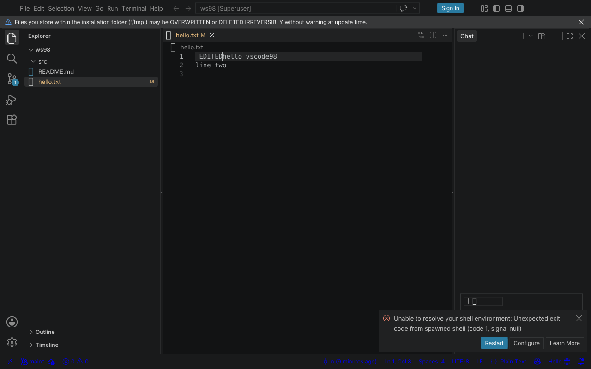

# Spike 10 — the main-process shim: VS Code's own electron-main, without Electron

**Question** (D-006, "process/IPC model"; the open item of the spike 8 README): spike 8 booted the *web* workbench because the desktop one needs a main process. What does it take to boot the **desktop** workbench, with the real window, shared process, file service and extension host, on the stack of spikes 2 to 9 and no Electron?

- **Host:** `qjs-spike7` (QuickJS-ng 0.17.0, x86-64, spike 5/7 host); Intel Xeon @ 2.1 GHz, 4 vCPU, Linux, headless 1280×800. Node 22 was used for discovery runs only.
- **Everything is VS Code's own code, unmodified:** the `build/next` bundle of the **desktop** target (`out/main.js` + `mainImpl.js` = the entire electron-main process, `bootstrap-fork.js` + the utility entries, `workbench.desktop.main.js`). What is ours: a 190-line stand-in for the `electron` module, a page-side `preload`, a message-port relay, JavaScript stand-ins for four native addons, and fixes to the spike 2/5 Node shims.
- **Nothing here ran on Windows, nothing was drawn in a window:** the renderer is the spike 6/7 DOM + layout + rasterizer driven headless, input is synthetic.

## Verdict

1. **The Electron boundary is thin.** VS Code's electron-main imports Electron in 47 files, but a 190-line module (`electron_stub.mjs`) is enough to run the whole main process: of its API only `app`, `BrowserWindow`/`webContents`, `ipcMain`, `utilityProcess`, `MessageChannelMain`, `screen`, `powerMonitor`, `systemPreferences`, `nativeTheme` and `Menu.setApplicationMenu` need behaviour; the rest of what it touches while booting, opening a folder and starting the extension host is **13 calls that can be no-ops** (`session.*` request interception and permission handlers, `protocol.handle`/`registerSchemesAsPrivileged`, `setProxy`, `crashReporter.start`, `safeStorage.isEncryptionAvailable`). The real main creates the window, builds the **real window configuration** (`INativeWindowConfiguration`, product, profiles, perf marks...), serves it over `vscode:` IPC, starts the shared process, file watcher, extension host and language servers.
2. **The desktop workbench runs with every process on QuickJS-ng**: main, shared process, file watcher, extension host, the JSON language server, and the renderer. Steps checked end to end (`results/quickjs-edit-scenario.txt`): the main process creates the window 0.28 s after start; the workbench renders the Welcome page (see below); `code <folder>` opens a folder and the Explorer lists it through the real file service in the shared process; a click opens `hello.txt`; typing ` EDITED` and Ctrl+S **changes the file on disk**; with a git repository open, **the git extension (running in the QuickJS extension host, spawning the real `git`) puts the branch `main` in the status bar** (`scenario_status.mjs`); the extension host starts the JSON language server (`jsonServerMain`, a fifth QuickJS child).
3. **It costs memory and time, like spikes 8/9.** Process tree after settling (`scenario_procs.mjs`): renderer 704 MB, main 47 MB, shared process 52 MB, extension host 71 MB, file watcher 9 MB, JSON server 9 MB: **892 MB**, of which 79 % is the renderer (the unresolved memory problem of spike 8; the five other processes together are 188 MB, small next to Node's ~40 MB *idle* per process). Time until the DOM stops changing: 28 s without a folder, 60 s with one (spike 9's engine: native layout, incremental style). Opening a file: 56 to 109 layout passes, 10 to 15 s; a keystroke: 6 to 10 passes, 0.3 to 1.6 s of style+layout each (more passes than the web workbench's 4: the desktop one has more going on and the extension host and language server share the 4 cores).
4. **What is missing is host work, not VS Code work:** native addons (`@vscode/sqlite3`, `@parcel/watcher` here replaced by stand-ins; `@vscode/spdlog`, `node-pty`, `native-keymap`, Kerberos, the Windows-registry modules are stubs or untested), a few Node API gaps in the shims, the agent host (AI, scoped out of old Windows by D-008) which crashes on startup, shell-environment resolution (spawning `$SHELL -ilc`), and of course a real window, GDI, Windows. See "Gaps".



The screenshot is the end state of the `edit` scenario: all processes on QuickJS, the file was edited by synthetic key events and saved through the shared process; `M` in the Explorer and the badge on Source Control come from the git extension running in the QuickJS extension host. (The warning bar and the shell-environment notification are real: see Gaps.)

## Architecture

```
renderer harness (QuickJS, spike 6/7/9 engine)  ── JSON lines + { $u8 } binary codec ──  main process (QuickJS)
  window.vscode = preload98.js                     fork() IPC channel                      VS Code's out/main.js + mainImpl.js
  ipcRenderer ⇄ ipcMain, invoke/handle                                                    `electron` = electron_stub.mjs
  RemotePort (MessagePort stand-in)                                                         ├─ utilityProcess.fork() ── util_child_main.mjs ── bootstrap-fork.js
                                                                                            │     shared process · file watcher · extension host · agent host
                                                                                            └─ MessageChannelMain: ports relayed by main (ports98.js)
```

- **`electron_stub.mjs`** is the whole replacement of Electron's main-process API. `BrowserWindow` is a record; `webContents.send/postMessage/loadURL` become messages to the renderer harness, whose `ipcRenderer.send/invoke` come back as `ipcMain` events/handler calls (with the `senderFrame` that VS Code validates: `url` of the page, `parent: null`). `app` (paths, locale, `ready` emitted after the module graph registered its listeners, command-line switches), `screen`, `powerMonitor`, `systemPreferences`, `nativeTheme` are small real implementations; everything else is a recorder that logs each call (`ELECTRON_STUB_LOG=file`), which is how the list of 13 was found.
- **`utilityProcess.fork`** starts a real child process (`util_child_main.mjs`, QuickJS or Node) that installs `process.parentPort` (messages are queued until someone listens, as in Electron: the entry module is still loading when the first message arrives), the `electron` stand-in and the port table, then runs `bootstrap-fork.js` with `VSCODE_ESM_ENTRYPOINT` as Electron's utility process does.
- **Message ports.** Electron passes real `MessagePort`s between processes (shared process ⇄ window, extension host ⇄ window, agent host ⇄ window). Here each end lives in one process and **main relays** (`postFrom`): a port posts `{t:'portMsg', id, data, ports}` to main, main forwards it to whichever process currently holds the peer; transferred ports change holder. Same API on both sides (`on('message')`, `onmessage`, `start`, `close`). Costs an extra hop and a base64 conversion per message; fine for this spike, not for the final design.
- **IPC codec** (`codec98.js`): every hop is JSON lines (what QuickJS's `fork()` and Node's `serialization: 'json'` speak); typed arrays travel as `{ $u8: base64 }`.
- **Page side** (`preload98.js`): `window.vscode` as the real `preload.ts` builds it (`ipcRenderer` with `vscode:`-only channels, `ipcMessagePort.acquire` re-posting ports through `window.postMessage`, `process`, `context.resolveConfiguration`), over the harness transport. The page is the product's own `workbench.html`; `vscode-file://vscode-app/<abs path>` URLs are mapped to files by a resolver hook (`import()`), the font/stylesheet readers and `fetch`.
- **Native addons** (`native_addons98.js`, hooked in through `globalThis.__loadNativeAddon`, called by the Module shim for every `.node` file): a JSON-file backed emulation of the SQL subset the storage service uses (`ItemTable`; the real `.vscdb` is not read), a polling replacement for `@parcel/watcher` (1 s), and a lenient stub for anything else.

## What had to be added or fixed in the shared host code

| Where | What |
|---|---|
| Module shim (`02-node-shim/host/impl/module.js`) | `.node` files go to `globalThis.__loadNativeAddon` instead of being compiled as JavaScript |
| `events.js` | `on`/`off` are now the same functions as `addListener`/`removeListener` (Node's aliasing; before, readable-stream and the sqlite3 `Database` recursed to a **native stack overflow, segfault**), methods are enumerable (sqlite3's own `inherits` copies them), state is created lazily (native-style subclasses never run the constructor) |
| `fs.js` | fd-level functions (`fstat`, `ftruncate`, `fsync`, `futimes`, `truncate`, `chmod`, `link`), flags `wx`/`w+`/`a+`/..., `readFile`/`writeFile` on fds and with `flag`, `FileHandle` for `promises.open`, `createReadStream`/`createWriteStream`, a polling `fs.watch` |
| `crypto.js` (new) | md5, sha1, sha256, sha512 and HMAC in JavaScript (verified against the system tools), `randomBytes`/`randomUUID`/`randomInt` from `/dev/urandom`. Without it the workspace id (md5 of the folder path) was `undefined` and folders silently did not open |
| `error_stack98.js` | QuickJS's `error.stack` is only the trace, without `Name: message`; VS Code logs `error.stack` everywhere, so every logged error lost its message. `stack` is an accessor on `Error.prototype` in QuickJS-ng and is wrapped once |
| `node_globals98.js` | web streams, `Blob`/`File`/`FormData`/`Headers`, `AbortController`/`AbortSignal`, `Event`/`EventTarget`, `MessagePort`/`MessageChannel`/`MessageEvent`..., `structuredClone` (placeholders, enough for packages such as undici to load) |
| Harness | `process.send` on utility children, `Module.globalPaths`/lookup stubs for `bootstrap-node.js`, the QuickJS unhandled-rejection tracker (spike 8) |

## Results

Commands: `host/build_desktop.sh` (bundle, ~50 s), `host/setup_qjs.sh` (shims), `tests/run_desktop.sh` (boot + scenario). Raw output: `results/`.

| | |
|---|---|
| Main process: start → window created | 0.28 s (QuickJS), 0.32 s (Node) |
| Renderer: time until the DOM stops changing, no folder / folder open | 28 s / 60 s (QuickJS, native layout; Node with the JS layout 36 s / 90 s) |
| Open a file from the Explorer | 56 to 109 layout passes, style 6.0 to 9.5 s + layout 2.1 to 3.8 s (10 to 15 s wall) |
| One keystroke in the editor | 6 to 10 passes, 0.3 to 1.6 s |
| Save (Ctrl+S) | file on disk correct after the settle |
| RSS: renderer / main / shared / ext host / watcher / json server | 704 / 47 / 52 / 71 / 9 / 9 MB (total 892 MB) |
| Electron API calls that need behaviour | `app`, `BrowserWindow`+`webContents`, `ipcMain`, `utilityProcess`, `MessageChannelMain`, `screen`, `powerMonitor`, `systemPreferences`, `nativeTheme`, `Menu.setApplicationMenu` |
| Electron API calls that are no-ops | 13 (list in `results/`: `session.defaultSession.{protocol.handle, webRequest.*, setProxy, set*Handler}`, `protocol.*`, `app.setProxy`, `crashReporter.start`, `safeStorage.isEncryptionAvailable`) |

Scenarios (`host/scenario_*.mjs`): `edit` (explorer click, typing, save, check the file), `status` (status bar items), `procs` (process tree and RSS), `console` (renderer console entries by regex).

## Gaps and open items

| Gap | Effect observed |
|---|---|
| Native addons are stand-ins | storage is a JSON file (the real `state.vscdb` SQLite file is ignored), the file watcher polls once a second and was only exercised at startup (an external change was not tested), `@vscode/spdlog` is a stub so **no log files are written**, `node-pty` (terminal), `native-keymap`, `@vscode/deviceid`, Kerberos, the Windows modules untested |
| Agent host (`agentHostMain`) crashes on startup (`cannot read property 'indexOf' of undefined` inside a bundled SDK) | main restarts it 5 times, the chat view reports "Agent Host failed to start"; AI features are out of scope for old Windows (D-008) |
| Shell environment resolution | `spawn` of `$SHELL -ilc ...` exits 1 on QuickJS: "Unable to resolve your shell environment" notification |
| `console.error` noise | ~180 `EntryNotFound (FileSystemError)` entries: probes for optional files are logged at error level in this host (not reproduced under Node); not investigated |
| Message-port relay through main | an extra hop and base64 per message; Electron's direct ports have neither. A real design needs ports that processes can connect to each other (socket pairs or a broker that hands over file descriptors) |
| Binary IPC via base64 JSON | measurable overhead for large messages; a framed binary channel is the obvious replacement |
| Renderer memory | 704 MB (spike 8/9 finding, unchanged) |
| Windows | nothing ran there: the process model (`CreateProcess`, pipes/sockets event loop, spike 5 finding), the window, GDI, the Win32 parts the real `BrowserWindow`/`Menu`/`dialog`/`shell`/`clipboard` stand-ins must provide (the stub lets all of these no-op or fail today: **there is no way to open a file dialog, a menu or the clipboard**) |
| Tests | none automated beyond the scenarios; the run takes minutes |

## Files

- `host/electron_stub.mjs`, `host/run_main.mjs`, `host/util_child_main.mjs`, `host/ports98.js`, `host/codec98.js`, `host/native_addons98.js`, `host/node_globals98.js`, `host/error_stack98.js` — the main-process side (QuickJS or Node)
- `host/boot_desktop_qjs.mjs` (QuickJS renderer harness, forks main), `host/boot_desktop_node.mjs` (Node twin, JS layout, faster discovery), `host/preload98.js`, `host/loader_hooks.mjs`, `host/run_utility_node.mjs` (runs one utility entry by hand)
- `host/build_desktop.sh`, `host/setup_qjs.sh`, `tests/run_desktop.sh`, `host/scenario_{edit,status,procs,console}.mjs`
- Changes in other spikes' files: `02-node-shim/host/impl/{module,events,fs,crypto}.js`
