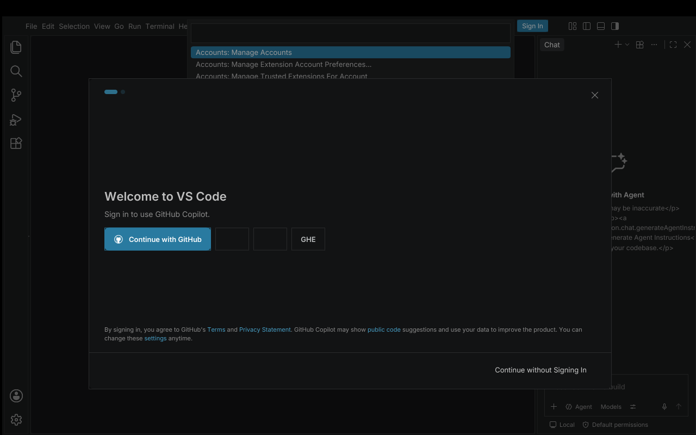

# Spike 11 — the host on Windows (x86, Windows 7 first)

**Question** ([CHECKPOINT](../../CHECKPOINT.md), D-006, spike 5's "Windows" analysis, spike 10's last open item): the whole stack (QuickJS host, Node shims, process model, main-process shim, software renderer) has only ever run on Linux. What does it take to run it on Windows 7, 32-bit, with a real window and no runtime to install?

- **Almost everything below ran under Wine 9.0 on Linux (cross-compiled with mingw-w64).** Wine is not Windows; it found real bugs (Win32 error codes, module identity) but can hide others. The self-test package (`package/`, `host/package_win.sh`) was then run on a **real Windows 7 Professional, build 7600 (no service pack), x86, 2 GB RAM, 2 vCPUs of an AMD Ryzen 5 5600G VM**: tests 1 to 4 (host start, processes/pipes/IPC/kill, `child_process.fork` through the Node shims, `net` over named pipes) **all passed unchanged** (`results/win7-vm/`). The window test (5) and the desktop workbench have not yet been run there.
- **Target of the build:** Windows 7 SP1 and later, 32-bit (`-march=i586 -mno-sse -mno-sse2 -mno-mmx -mfpmath=387`, the baseline of spike 7) and 64-bit. Imports only `kernel32`, `user32`, `gdi32`, `msvcrt` (all present in a clean Windows 7; no Visual C++ runtime). **Windows XP is blocked by four functions** QuickJS itself imports (below).
- **Host:** QuickJS-ng 0.17.0 + the spike 5/7 native modules; the same JavaScript as on Linux.

## Verdict

1. **The host cross-builds and runs on Windows** (1.6 MB exe). The stock QuickJS compiles for mingw with a small patch of `quickjs-libc.c` (four hunks in the Windows poll loop); the spike 7 rasterizer and layout engine needed one change (a timer, `render.c`) and render **the same pictures**: the web workbench boot of spike 8 runs on the .exe under Wine and reaches the same Welcome / chat screen.
2. **A native process/pipe layer for Windows (`winproc.c`, ~600 lines of C) replaces POSIX `proc.c` behind the same JavaScript.** Overlapped named pipes, `CreateProcess` with handles passed by value, waitable process handles, named-pipe servers: `child_process.fork()` with an IPC channel (the spike 5 tests: JSON messages up to 280 KB, stdio pipes, disconnect, kill, spawn failure), `net` over `\\.\pipe\...`, `spawnSync`, 2.5 MB through a pipe — all pass (`results/`). This is the part of spike 5's "Windows event loop" analysis that was open; it is solved without changing QuickJS beyond the event-loop hook.
3. **A Win32 window (`winwin.c`, ~145 lines, GDI only).** The framebuffer of the native rasterizer is blitted with `BitBlt`; mouse (with capture and hover tracking), wheel, keyboard (virtual keys, `WM_CHAR` text) and size events reach JavaScript from inside the QuickJS event loop (the loop waits with `MsgWaitForMultipleObjects`). `window_host98.mjs` turns them into DOM events (hit testing with `elementFromPoint`, focus, `keydown`/`input` for Monaco's input area).
4. **The desktop workbench of spike 10 runs on the Windows .exe under Wine in a window**: main process (VS Code's own electron-main bundle, Windows code paths: `isWindows` branches in `mainImpl.js`), shared process, file watcher, extension host, agent host (crashes, as on Linux), renderer; F1 typed on the X keyboard through Wine opens the real Command Palette (`results/desktop-window-wine.png`). The headless run settles in 76 s under Wine (Linux native: 60 s for spike 10's folder run); a real Windows number is not known.
5. **What it still needs is host work and a real machine:** TCP sockets (Winsock), `.cmd`/`.bat` spawning, the XP condition-variable gap, Windows 9x (no `W` APIs, no overlapped pipes), native addon stand-ins, and every number on real hardware. See "Gaps".

## What was built

**Native (`host/`)**

| File | Lines | What |
|---|---|---|
| `build_win.sh` | | cross-build with mingw-w64: patched `qjs.c` (spike 7's seds + `spike_init_win`), a patched copy of `quickjs-libc.c`, spike 5's `esm.c`, spike 7's `render.c`/`layout.c`, `winproc.c`, `winwin.c`; 256 MB stack reservation (`--stack`), static libgcc |
| `patch_libc.py`, `winhook.h` | 40 | the hook: QuickJS's Windows poll loop only waits on stdin and worker ports; the patch asks `js_win_waiter` for extra handles (pipes, process handles, events), dispatches to it when one is signalled, keeps the loop alive while it has work, and waits with `MsgWaitForMultipleObjects` while a window exists |
| `winproc.c` | ~600 | module `spike:proc`, same names and conventions as the POSIX one (negative Linux errno values, `EAGAIN = -11`): `pipe(childEnd)`, `socketpair`, `read`/`write`/`close`/`setReadHandler`/`setWriteHandler`, `spawn`, `watchExit`, `kill`, `pollSync`, `listenUnix`/`accept`/`connectUnix` for named pipes, `rename` (replace-existing), `exePath` |
| `winwin.c` | ~145 | module `spike:win`: `create`, `present`, `setHandler`, `setCursor`, `setTitle`, `size`, `screenSize`, clipboard get/set |
| `check_imports.sh` | | lists the DLL imports and flags functions that do not exist before Vista |

**JavaScript**

- `window_host98.mjs`: window ⇄ DOM (events, repaint when `doc.__dirty`, cursor from `getComputedStyle`).
- Shim changes (shared with Linux; Linux behaviour unchanged): the `path` shim is now VS Code's own port of Node's path module (`vspath.js`, generated by `host/build_path.sh`; win32 flavour on Windows) with `fromFileUrl`/`toFileUrl`; `url`, `os`, `module` (`node_modules` lookup), `process.platform/cwd`, `fs` (recursive `mkdir`, `lstat` fallback, Win32 error codes, replace-on-rename, fd functions already from spike 10), `events` unchanged; `fdio.js` routes descriptor I/O to `spike:proc` on Windows; `child_process` (exit via process handles, `shell` through `%ComSpec% /d /s /c`, verbatim arguments); ESM loader (module names canonical with `/`: a module loaded under two spellings is instantiated twice, which silently split `Module.__hooks` in the first attempt).
- Desktop harness: `--window 1` (paths, `vscode-file://vscode-app/c:/...`, stand-ins for Windows-only native packages: policy-watcher, native-keymap, windows-mutex/registry/process-tree, native-is-elevated, foreground-love).
- `host/package_win.sh` + `package/selftest.cmd`: a relocatable test package (6.7 MB).

## Results (all under Wine; `results/`)

| Test | Result |
|---|---|
| `tests/proc_raw.mjs` (spawn, stdio pipes, duplex IPC pipe, exit codes, kill, ENOENT, pollSync, 2.5 MB backpressure) | 10/10 pass |
| spike 5 `fork_parent.cjs` through the Node shims (`fork`, IPC messages up to 280 KB, disconnect, kill, spawn error) | pass |
| `tests/net_pipe.cjs` (named-pipe server, 3 concurrent clients, 300 KB echo, missing pipe → ENOENT, `server.close`) | 4/4 pass |
| `tests/win_gdi.mjs` under Xvfb + xdotool (window, gradient blit, mouse down/up/move, wheel, key down/char/up, backspace, ctrl+A) | events and pixels as expected |
| web workbench boot (spike 8) on the .exe | boots to the same screen as on Linux (968 elements, 157 layout passes) |
| desktop workbench boot headless on the .exe (main + utility processes + renderer), no folder | 76 s until the DOM stops changing, 792 elements, 227 layout passes, 63 rects painted |
| desktop workbench in a window: F1 → Command Palette | works |
| x86 exe size / DLL imports | 1.6 MB; KERNEL32, USER32, GDI32, msvcrt |

## How to run it on a VM

1. Windows 7 SP1 32-bit, 2 GB RAM, 2 vCPUs, 1280×800, no 3D (the spec given in the conversation).
2. Unzip `dist/vscode98-win-selftest-x86.zip` (built by `host/package_win.sh dist-dir x86`; not committed, it is a build product) anywhere and run `selftest.cmd` in `cmd.exe`. It writes `results\` (system info, one text file per test). The window test needs you to move the mouse over the window, click, scroll and type for 15 s.
3. Send `results\` back. The desktop workbench needs the 300 MB app bundle on top (`host/build_desktop.sh` of spike 10 + `node_modules`); a second package for it comes after the self test passes.

## Gaps and findings

| | |
|---|---|
| **Only partly verified on Windows** | the process, pipe, fork and named-pipe tests pass on a real Windows 7 (build 7600, x86); the GDI window, the web/desktop workbench and all timings were only run on Wine so far. Known differences that matter: Wine's named pipes, overlapped I/O and `MsgWaitForMultipleObjects` are re-implementations; GDI under Xvfb has no DWM/Aero; process creation timing; DPI virtualization (the exe calls `SetProcessDPIAware` when present) |
| **Windows XP does not load the exe** | QuickJS imports `InitOnceExecuteOnce`, `InitializeConditionVariable`, `SleepConditionVariableCS`, `WakeConditionVariable` (Vista+, for worker threads / `Atomics.wait`). Everything of mine avoids Vista-only calls (`check_imports.sh`). Fix: replace the four with `GetProcAddress` fallbacks built on events and a critical section (a small patch of `quickjs.c`/`quickjs-libc.c`'s pthread-like layer) |
| **Windows 9x** | not started: no `W` entry points (all of `winproc.c`/`winwin.c` use them) and no overlapped I/O on pipes (NT only). The thread-based reader for non-overlapped handles already exists (it is what handles inherited std handles), so pipes can be done with threads; `CreateProcess` + handle inheritance exist on 95/98 |
| **TCP / `dgram` / `tls`** | `listen`/`connect` by host and port return ENOSYS (needs Winsock with `WSAEventSelect` handles in the same wait set). Named pipes (what VS Code uses on Windows for its own IPC) work |
| **Pipe half-close** | a pipe has none: `socket.end()` sends the queued data, then closes the whole handle; a peer that keeps sending after our `end()` is lost |
| **`.cmd` / `.bat`** | `spawn` without a shell cannot start them (as in Node ≥ 20.12); `shell: true` goes through `cmd.exe` |
| **Symlinks, `lstat`** | QuickJS has none on Windows; `lstat` is `stat` |
| **Wait set limit** | 64 handles (`MAXIMUM_WAIT_OBJECTS`): fine for a workbench (a dozen pipes), a concern for many sockets |
| **Native addons** | still the spike 10 stand-ins (JSON storage instead of SQLite, polling watcher) plus new ones for the Windows-only packages; `@vscode/spdlog` stub means no log files |
| **Agent host** | crashes at start-up as on Linux (out of scope on old Windows, D-008) |
| **Speed** | Wine: 76 s to settle (Linux native 60 s with a folder, 28 s without). Real hardware unknown |
| **Startup of the window** | the first paint happens after the workbench's own start-up; a window with a splash would show something earlier |

## Files

`host/{build_win.sh, patch_libc.py, winhook.h, winproc.c, winwin.c, window_host98.mjs, check_imports.sh, build_path.sh, package_win.sh}`, `tests/{proc_raw.mjs, net_pipe.cjs, win_gdi.mjs}`, `package/selftest.cmd`, `results/`. Changed in other spikes: `02-node-shim/host/{globals.js, impl/{path,os,url,module,fs,events,crypto,vspath}.js, gen_shims.mjs}`, `05-child-process/host/{esm_loader,fork_main,proc_setup,build_impl}.mjs`, `05-child-process/host/impl/{child_process,fdstreams,net,fdio}.js`, `05-child-process/tests/fork_parent.cjs`, `07-native-render/host/render.c`, `10-main-shim/host/*` (hooks, stubs, harness).
